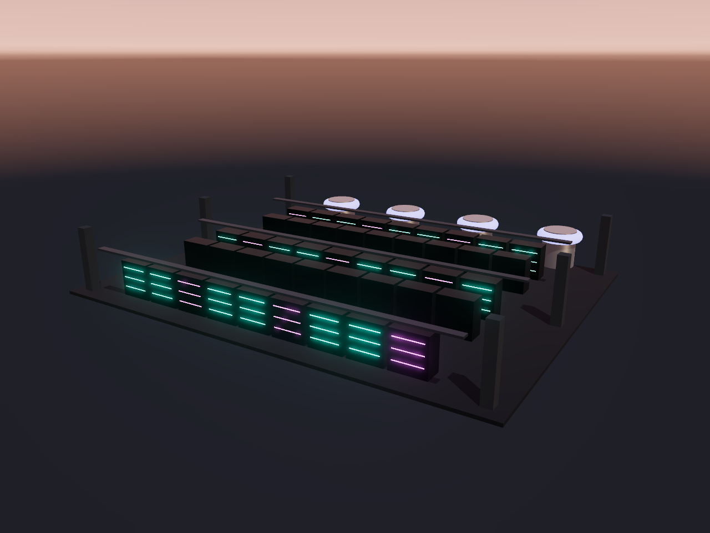

# orbyt

**A 3D engine that AI agents drive.** Real-time WebGL2 rendering with **Flare**, offline path tracing with **Bake**, and an **MCP server** (`orbyt-mcp`) that gives an agent a live scene to edit, render and review.

orbyt is built on [three.js](https://threejs.org) (r187) and [three-gpu-pathtracer](https://github.com/gkjohnson/three-gpu-pathtracer). It adds sensible defaults (PBR, ACES tone mapping, HDR bloom, MSAA, fitted shadows, studio lighting, auto-framing) and an agent-friendly scene model on top.



## Install

```bash
npm install orbyt@npm:@orbythq/orbyt@0.9.2
```

The package is published as `@orbythq/orbyt`; the alias above lets you import it as `orbyt`.

## Quick start

```js
import { Flare } from 'orbyt';
import { loadGltf } from 'orbyt/addons/gltf';
import { loadHdri } from 'orbyt/addons/hdri';

const { parts } = await loadGltf('/server-hall.glb');
const map = await loadHdri('/dusk.hdr');
const renderer = new Flare(canvas, parts, {
  hdr: true,
  ground: false,
  environment: { map },
});

renderer.render({ eye: [42, 28, 60], target: [0, 2, -6] });
```

No model handy? Build parts from primitives:

```js
import { Flare, createPrimitive } from 'orbyt';

const parts = [
  createPrimitive('box', { size: [2, 1, 1], position: [0, 0.5, 0], material: { color: '#2dd4bf', roughness: 0.3 } }),
  createPrimitive('sphere', { radius: 0.6, position: [-1.8, 0.6, 0], material: { color: '#e879f9', metalness: 1, roughness: 0.15 } }),
];
const flare = new Flare(canvas, parts);
flare.render(); // no eye/target → the whole scene is framed automatically
```

## API

### `new Flare(canvas, parts, options?)`

Real-time WebGL2 renderer. `canvas` is an `HTMLCanvasElement` or `OffscreenCanvas`. `parts` is a `Part[]` (`{ name, object, animations? }`), a three.js `Object3D`, or an array of either.

| option | default | |
| --- | --- | --- |
| `hdr` | `true` | Half-float HDR pipeline: MSAA render target → bloom → ACES output pass. `false` renders straight to the canvas (still ACES). |
| `bloom` | on | `false`, or `{ strength = 0.3, radius = 0.35, threshold = 1 }`. Only HDR highlights (emissive > 1) bloom by default. |
| `samples` | `4` | MSAA samples. `0` disables anti-aliasing. |
| `pixelRatio` | `min(devicePixelRatio, 2)` | |
| `shadows` | `true` | `true`, `false`, or a shadow-map size. The sun's shadow frustum is fitted to the scene bounds. |
| `ground` | `true` | Shadow-receiving ground under the scene (fades into the background), or `{ color, roughness, y }`. |
| `environment` | studio | `{ map, intensity, background, blur, rotation }`. `map` is an equirect texture from `loadHdri()`; without one a neutral studio environment (RoomEnvironment) lights the scene. |
| `background` | `#060b10` | Solid background when the environment map is not shown. |
| `sun` | on | Key directional light: `false` or `{ direction, color, intensity = 1.8 }`. |
| `exposure` | `1` | Tone-mapping exposure. |
| `preserveDrawingBuffer` | `false` | Set to read pixels back after a frame (`canvas.toDataURL()`). |
| `renderer` | – | Reuse an existing `THREE.WebGLRenderer`. |

Methods:

- `render({ eye?, target?, fov?, exposure?, time?, mode? })`: draws one frame. Omitted fields keep their previous value; with no `eye` the camera frames the whole scene. `time` (seconds) drives animation clips from glTF parts (skinning, morphs). `mode: 'normals'` renders view-space normals for visual review.
- `resize(width?, height?)`: matches the drawing buffer to the canvas' CSS size (or the given size). Call it from a `ResizeObserver`.
- `replaceParts(parts)`: swaps the scene content and keeps renderer, environment and camera.
- `refit()`: recomputes bounds, ground and shadow frustum after you move parts yourself.
- `setEnvironment(map | null)`: swaps the HDRI at runtime.
- `dispose()`
- Escape hatches: `flare.renderer`, `flare.scene`, `flare.camera`, `flare.stage`.

### `new Bake(canvas, parts, options?)`

Progressive path tracer for stills. It takes the same stage options as Flare (`ground`, `environment`, `background`, `sun`), plus `bounces` (default 6), `pixelRatio` (default 1) and `exposure`.

```js
import { Bake } from 'orbyt';
const bake = new Bake(canvas, parts, { environment: { map } });
const image = await bake.render({ eye: [6, 4, 8], target: [0, 1, 0], samples: 128, onProgress: (n, total) => {} });
img.src = image.toDataURL(); // or await image.toBlob()
```

`render()` resolves to `{ samples, ms, canvas, toDataURL(), toBlob() }`. It also accepts `signal` (an AbortSignal) and `timeoutMs`, which returns whatever has accumulated so far. The first bake compiles a large shader. That takes a few seconds on most GPUs and up to about 45 s with ANGLE/Direct3D 11 on Windows. Later bakes start immediately.

### Parts and materials

- `createPrimitive(shape, { size, radius, height, detail, position, rotation /* degrees */, scale, material, name })`. Shapes: `box`, `sphere`, `cylinder`, `cone`, `plane`, `torus`, `torusKnot`, `capsule`, `icosahedron`.
- `createMaterial(spec)` / `applyMaterial(material, spec)`. The spec is `{ color, metalness, roughness, emissive, emissiveIntensity, opacity, transmission, ior, thickness, clearcoat, alphaTest, doubleSided, flatShading, wireframe }`. When `transmission` or `clearcoat` is set you get a `MeshPhysicalMaterial` (glass); otherwise a `MeshStandardMaterial`.
- `toParts(input)` normalises any accepted input to `Part[]`.

### `orbyt/addons/gltf`

`loadGltf(urlOrArrayBuffer, { split = 'top' | 'whole', dracoPath, path, onProgress })` resolves to `{ parts, scene, animations, gltf }`.

With `split: 'top'` you get one part per top-level node. A single wrapper root node, which many exporters add, is unwrapped and world transforms are kept. Files with animations are loaded whole so their clips can reach every node. Meshopt compression works out of the box. Pass `dracoPath` to enable Draco.

### `orbyt/addons/hdri`

`loadHdri(urlOrArrayBuffer, { format?: 'hdr' | 'exr' | 'ldr' })` loads an equirectangular `.hdr`, `.exr`, `.jpg`, `.png` or `.webp` as a texture ready for `environment.map`. `parseHdri(buffer, 'hdr' | 'exr')` parses one already in memory.

## MCP server: `orbyt-mcp`

```bash
npx orbyt-mcp --backend gpu --memory 256
```

The server speaks MCP over stdio and keeps one live scene per session. Rendering runs Flare/Bake in a headless Chromium page that the server starts on first use. It looks for, in order: `--browser <path>` or `ORBYT_BROWSER`, a Playwright-installed Chromium, Google Chrome, then Microsoft Edge. If none is found, install one (`npx playwright install chromium`) or point `ORBYT_BROWSER` at Chrome.

| flag | default | |
| --- | --- | --- |
| `--backend gpu\|cpu` | `gpu` | `gpu` uses hardware WebGL2 (falls back to `cpu` automatically if the headless browser has no GPU). `cpu` uses SwiftShader software rendering: slower, but it works on any machine and in CI. |
| `--memory <MiB>` | `256` | Renderer budget. It sets the browser JS heap, the largest frame (≈ MiB × 16 384 px, so 256 → 4 MP; bigger requests are downscaled and the reply says so) and the largest model/HDRI file (MiB / 2). |
| `--browser <path>` | auto | Chromium, Chrome or Edge executable. |

Add it to an MCP client, for example Claude Code:

```bash
claude mcp add orbyt -- npx -y -p @orbythq/orbyt@0.9.2 orbyt-mcp --backend gpu --memory 256
```

or to any client's JSON config:

```json
{
  "mcpServers": {
    "orbyt": { "command": "npx", "args": ["-y", "-p", "@orbythq/orbyt@0.9.2", "orbyt-mcp", "--backend", "gpu", "--memory", "256"] }
  }
}
```

Units are metres, Y is up and rotations are in degrees. Relative file paths resolve against the server's working directory.

### Tools

The website advertises 19 tools. 18 are implemented in 0.9.2 and one is on the roadmap.

| # | tool | status | what it does |
| --- | --- | --- | --- |
| 1 | `create_scene` | ✅ | New empty scene, or `{ from }` a file written by `save_scene` |
| 2 | `add_primitive` | ✅ | box / sphere / cylinder / cone / plane / torus / torusKnot / capsule / icosahedron with transform and material |
| 3 | `load_model` | ✅ | Add a local `.glb`/`.gltf`; replies with mesh count, triangles and size |
| 4 | `remove_part` | ✅ | Remove a part or light |
| 5 | `list_parts` | ✅ | Ids, kinds and positions |
| 6 | `describe_scene` | ✅ | Full scene JSON plus measured world bounds, triangles, materials per part, and the GPU in use |
| 7 | `set_transform` | ✅ | Absolute position/rotation/scale, relative `translate`, `visible` |
| 8 | `set_material` | ✅ | PBR material override (merge or replace); on models it applies to every mesh |
| 9 | `add_light` | ✅ | Directional, point or spot light |
| 10 | `set_camera` | ✅ | Eye, target, fov, or `auto` framing |
| 11 | `set_environment` | ✅ | HDRI, intensity, background, blur, rotation, ground, sun, bloom, shadows, exposure |
| 12 | `explode_parts` | ✅ | Exploded view: pushes parts away from the scene centre |
| 13 | `render_frame` | ✅ | Flare frame → PNG (optionally also written to `out`) |
| 14 | `render_views` | ✅ | Labelled 2×2 sheet: front / right / top / perspective (beauty or normals) |
| 15 | `render_normals` | ✅ | Surface normals from the scene camera, to find flipped faces and seams |
| 16 | `bake_frame` | ✅ | Path-traced still with Bake (`samples`, `timeoutSeconds`) |
| 17 | `export_glb` | ✅ | Write the scene to a binary glTF |
| 18 | `save_scene` | ✅ | Save the editable scene description (JSON) |
| 19 | `blend_parts` | 🗺 roadmap | Mesh blend / boolean (union, subtract) between parts |

Tool failures, such as an unknown id or a missing file, come back as MCP tool errors with a message the agent can act on. The server does not crash.

## Status against the website's feature list

| feature | 0.9.2 |
| --- | --- |
| PBR materials, HDR + bloom, MSAA, HDRI lighting, glass and alpha cutouts | ✅ |
| GLB import and export | ✅ (export through `export_glb` / three's `GLTFExporter`) |
| Skinning and morphs | ✅ glTF animation clips play through `render({ time })` |
| Bake path tracer | ✅ |
| Shadows | ✅ one fitted shadow map; **cascaded** shadows are on the roadmap |
| Mesh blend, soft bodies, volumetric fog, rigid physics, fluid surfaces, procedural terrain, foliage scatter, vehicles | 🗺 roadmap |

## Bundle size

Measured with `npm run size`: esbuild, minified and tree-shaken, gzip -9.

| bundle | gzip |
| --- | --- |
| orbyt's own code (three external) | 3.5 KB |
| lit box with orbyt (three + PMREM + bloom + orbyt) | 148.6 KB |
| lit box with Flare + Bake (adds the path tracer) | 209.2 KB |
| lit box with plain three.js (no post-processing) | 130.8 KB |

orbyt sits on top of three.js, so an orbyt app is about 18 KB gzip larger than a bare three.js one. That extra covers the HDR pipeline, bloom and environment lighting.

## Examples

```bash
npm install
npm run build
npm run example      # http://localhost:5173/examples/
```

`examples/index.html` runs the snippet from the website verbatim, then orbits the camera. **Bake 64 spp** path-traces the current view. The assets in `examples/assets` are generated by `npm run assets`. The HDRI is procedural, and the server hall is built with the MCP tools and written out with `export_glb`.

## Development

```bash
npm run build       # tsup → dist/ (ESM + .d.ts, CLI, headless runtime bundle)
npm test            # builds, then Vitest: unit tests + end-to-end MCP over stdio with real renders
npm run typecheck
node scripts/smoke.mjs gpu   # manual MCP smoke run, PNGs in test/.out/
```

The end-to-end tests need a Chromium-family browser. Set `ORBYT_SKIP_E2E=1` to skip them.

## License

MIT © Lumora Labs
